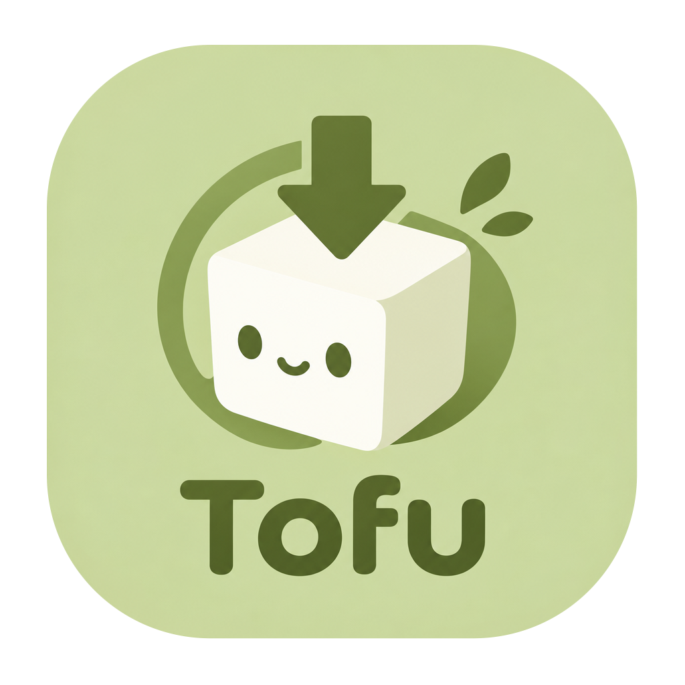

# Tofu

A desktop torrent client with a clean interface, real transfer stats, and built-in anime tracking.

[](.github/assets/tofu-demo.mp4)

[Watch the 53-second demo](.github/assets/tofu-demo.mp4)

Built with **Bun · React · Furin · Electrobun · WebTorrent**, using **shadcn + Base UI**.

## ✨ What you can do

- **Download your way** — add magnets, torrent URLs, or `.torrent` files, including drag and drop.
- **Keep things organized** — give each destination its own tab and folder.
- **Search everywhere** — press `Cmd+K` (or `Ctrl+K`) to find torrents across all threads, search enabled sources, and review releases before downloading into a chosen thread.
- **Stay in control** — pause, resume, set file priorities, manage trackers, and verify downloads.
- **Follow new releases** — search Nyaa, Tsundere-Raws, and C411; automate downloads with optional AniList integration.
- **Pick up where you left off** — downloads and settings survive restarts; background mode keeps transfers running.

Files stay on disk unless you explicitly choose to delete them. Unavailable stats appear as `—`.

If downloaded files disappear or change, Tofu stops the transfer and reports a storage problem. **Repair download** verifies the remaining pieces before downloading missing data; a paused torrent stays paused. **Locate files** verifies an existing folder without moving or deleting anything. Disconnected or replaced destinations are never recreated automatically: reconnect the original storage or select its new location. Storage problems survive restarts, and inaccessible data is shown as unknown until verified.

Tofu writes evlog wide events to dated NDJSON files in `logs/` inside its data directory, such as `2026-10-20.jsonl`. On macOS, release logs are in `~/Library/Application Support/Tofu/logs/`; development uses `Tofu-dev`. **Settings → General → Open logs folder** opens them in the desktop app. Events record API and page requests, selected operation errors, player diagnostics, and torrent storage failures with their original system codes, stacks, and directory identities. API requests use `evlog/elysia` for both HTTP and direct Eden dispatch; Furin logs other routes without duplicating API events. Configuration lives in `evlog.config.ts`, and the global logger is initialized in `src/server.ts`. Speed and progress updates are omitted. The file drain rotates at a 5 MiB threshold and retains four files; a batch can exceed the threshold before the next rotation. Credentials, request bodies, and headers are excluded or redacted. Buffered events are flushed on shutdown. Logs stay on the machine hosting Tofu and are not uploaded.

## 📦 Install

Download an installer matching your system from [Releases](https://github.com/Teyik0/Tofu/releases). The release pipeline targets macOS Apple Silicon, Windows x64, and Linux x64/ARM64.

On macOS, open the DMG and move Tofu to Applications. On Windows, extract the entire ZIP before running `Tofu-Setup.exe`; keep its `.installer` folder alongside it. On Linux, extract the `.tar.gz` and run `./installer`.

macOS releases use free ad hoc signing unless an Apple Developer ID is configured. These releases are not notarized, so macOS may block the first launch. After downloading from the official releases page, try opening Tofu, dismiss the alert, then go to **System Settings → Privacy & Security → Open Anyway** and confirm **Open**. See [Apple's instructions](https://support.apple.com/en-us/102445) for details.

On macOS, choose **Tofu → Set as default torrent app** to open `.torrent` files and magnet links with Tofu. Opening a torrent starts it in your saved download folder; reopening an existing torrent preserves its destination and paused state. You can also select Tofu in Finder's **Get Info → Open with → Change All…** for `.torrent` files. The development app does not advertise file or magnet associations.

In **Settings → General**, **Set Tofu as default** changes the `.torrent` file association while keeping your magnet link application. This action requires the installed release; some systems ask you to complete the choice in their default application settings.

**Delete .torrent file after adding** is off by default. When enabled, a successful import from your file manager permanently removes the original `.torrent` file after Tofu has saved its metadata. Downloaded content, invalid files, and files for torrents already in the library are kept. Browser uploads and drag-and-drop imports keep the original because they do not expose its filesystem path.

See the [release guide](docs/releases.md) for updates and signing details. macOS Apple Silicon is the currently validated platform.

## 🚀 Run from source

You need **Bun 1.4.3+** for the built-in `bun check` type checker. macOS also requires **Xcode Command Line Tools**. Linux requires GTK 3, WebKitGTK 4.1, Ayatana AppIndicator, and librsvg; see the [development guide](docs/development.md).

```sh
git clone https://github.com/Teyik0/Tofu.git
cd Tofu
bun install
bun run dev
```

Run `bun run dev` to prepare the runtime, generate the AniList client, and open the native app and a browser against the same authenticated backend. Furin manages the desktop supervisor. Use `bun run dev --web` to start only the web development server at `http://localhost:3000`, without launching the desktop app.

Frontend CSS and React changes use HMR in the existing window. Backend changes restart
its native host after releasing application resources; unsaved UI state is not preserved
across those restarts. Stop any compiled development instance before starting `bun run dev`,
since both normally use the same development profile.
Known development failures and their reproductions are recorded in the [HMR investigation](docs/hmr-investigation.md).

`bun run build` creates an optimized development app; `bun start` opens that existing build.
Its Tofu profile is embedded separately from `NODE_ENV`, so the window stays **Tofu Dev**
and AniList returns to `tofu-dev://oauth/anilist`. Rebuild after changing native configuration.

## 🧩 Plugins

Plugins are optional and start disabled. Enable them from **Plugins** in the sidebar.

| Plugin | What it adds |
| --- | --- |
| Nyaa | Torrent search and release feeds |
| Tsundere-Raws | Recent releases from the official JSON feed |
| C411 | Torznab search with your API key |
| AniList | Track selected anime from Watching and Plan to Watch |

[Plugin guide →](docs/plugins.md)

### Service composition

Each module exports its service class, Elysia plugin, and input types directly. Consumers declare their dependencies with `.use()`.

Services and HTTP management are separate. `automationPlugin` has no endpoints; `automation/management.ts` retains the existing interface API. `AutomationService` depends on SQLite, not Discovery, torrent execution, or source providers. The built-in `ReleaseAutomationService` collects releases, submits candidates, and executes committed decisions. AniList owns its account/media bindings and uses that release integration.

Each application initializes its services before serving requests. Elysia service plugins construct their shared instances once at module initialization and expose them with `decorate`. The database has its own plugin. The torrent service plugin owns the worker and exposes the ready engine through `.use(torrentServicePlugin)`. The global `src/sync.ts` builds Furin's SQLite adapter and notifier, then routes opt in with `furinSync(sync)`. AniList, Discovery, automation, source registration, and updates live in their own service plugins.

Desktop single-instance locking, activation, and native event handoff are managed by the Furin native host. The API entry exports `apiPlugin`; `server.ts` declares the root Elysia application and mounts the API before the desktop integration and Furin on one listener. The server-side Eden client dispatches directly to `apiPlugin`, without importing the server entry or making a network request.

Each service plugin registers cleanup when acquiring its resources. Asynchronous initializers use a local `await using` stack, then transfer ownership to the shared lifecycle stack with `resources.use(startup.move())`. The lifecycle plugin contains no business services. Cleanup runs in reverse acquisition order, keeping dependencies alive until their consumers stop. The server protects API loading, waits for in-flight initializers before cleaning up a failed import, and disposes the shared stack on shutdown. Background services start after runtime validation and network initialization.

An integration can consume the automation service without mounting its management API:

```ts
import { Elysia } from "elysia";
import { furinSync } from "@teyik0/furin/sync";
import { automationPlugin } from "./src/api/modules/automation";
import { draft } from "./src/api/modules/automation/model";
import { sync } from "./src/sync";

export const filmsPlugin = new Elysia({ name: "acme-films" })
  .use(automationPlugin)
  .use(furinSync(sync))
  .put(
    "/films/:id/rule",
    {
      body: draft,
      sync: { invalidate: { path: "/", type: "layout" } },
    },
    async ({ automation, body, params, mutation }) => {
      const prepared = await automation.prepareRule(null, body, [], {
        ownerId: "acme.films",
        key: params.id,
      });
      const rule = await mutation((tx) => automation.writeRule(tx, prepared));
      automation.refreshState();
      return rule;
    }
  );
```

Rules are reconciled by `(ownerId, key)`. Each configuration change increments `revision`; `prepareIngestion` and `writeIngestion` reject obsolete work. Integrations supply `{ contentKey, release }` candidates, active sources, existing torrent IDs, and collection errors. Network reads happen before the write transaction. Refresh in-memory state only after commit. For `includeExisting: false`, supply existing candidates when preparing a new rule; the core does not discover its own baseline.

The executor defaults to the rule's integration owner. Only `tofu.releases` rules are polled by Tofu's built-in scheduler; legacy rules remain compatible. An external integration is responsible for its own scheduling, execution, retries, and shutdown. Persisted `adding` decisions serve as pending actions. Report results with `writeDecisionResult`, supplying the collected rule revision. Execution is retryable, not exactly-once: use torrent hashes to recover an already added transfer. Manual approval persists across retries, and replacement removal waits until the new transfer completes.

Register a source with `plugins.registerSource` during application initialization, using a unique namespaced ID such as `acme.releases`. Its `search` callback receives the query, configured API key, and cancellation signal; an optional `download` callback receives the release and the same credentials/cancellation context. Source configuration persists, and new sources start disabled. Set `privateDownloads: true` when download or page URLs contain credentials. The registry keeps those URLs server-side in public snapshots. Register sources again on each startup before starting integrations.

The current candidate and policy contract remains release-oriented (`FeedRelease`, torrent destinations, quality preferences); this does not yet promise a universal workflow API. Third-party routes must be included statically in the application to participate in its inferred Eden type. Plugins execute trusted code in the host process.

## 🛠️ Development

`bun run dev` launches `furin dev`; append `--web` to run only the web development server, or `--desktop` to open only the native app. Frontend changes use Fast Refresh; backend and native changes restart the managed process. `src/server.ts` exports the Elysia root, mounts the API before the desktop integration, declares the primary window, and owns application startup and shutdown. `src/desktop.ts` registers original Electrobun menus, tray and SDK capabilities; `src/native/host.ts` manages remote server windows. Furin owns authenticated local windows, session bootstrap and coordinated quit, restart and update installation.

Packaging settings live in `furin.config.ts`. Development uses `NODE_ENV=development` and builds use production optimizations. The local `dev`, `build`, `db:generate`, and `db:push` scripts set `DATABASE_URL=./tofu-dev.sqlite` directly, independently of `NODE_ENV`; no environment file is needed. Run `bun run db:push` to apply schema changes locally. Release CI invokes the bundler directly without this local database override. The build-time variable does not configure a packaged application's launch environment. Without `DATABASE_URL` at runtime, the database is `tofu.sqlite` inside the resolved application data directory. The exported `instance` object defines application paths; the desktop host supplies its data directory through `FURIN_APP_DATA_DIR`. Each process owns one set of application services. Bundle outputs and release artifacts stay under `.furin/electrobun/`. `bun run tscheck` prepares the pinned Electrobun SDK before checking types; no desktop build is required. The vendored Furin and Electrobun integration archives are built together from [Furin PR #163, commit `e2c37e9`](https://github.com/Teyik0/furin/commit/e2c37e99f9014bc99146d8cc43281b55bca94868).

The torrent worker commits engine invalidations to the shared SQLite journal and sends the committed cursor with its snapshot. The server updates its cache before notifying Furin; cursor notifications do not poll SQLite. Transfer events schedule grouped telemetry publications while a browser is subscribed. With no subscribers, telemetry publications and chart sampling stop, while persistence and storage checks run every five seconds. State changes such as completion and storage errors still publish in the background. Peer connections and encryption continue independently of interface subscriptions.

```sh
bun run tscheck
bun run fix
bun run test
bun run build
```

`bun run test` runs integration scenarios grouped into `tests/torrents/`, `tests/library/`, `tests/lifecycle/`, `tests/anilist/`, `tests/plugins/`, and `tests/remote/`. Each scenario starts the real server in temporary directories and calls typed Eden endpoints. Transfers use real local peers; AniList and release providers use a local HTTP fixture through a test-only preload. Shared process, peer, provider, polling, and assertion helpers live in `tests/helpers/`. Coverage includes missing files after restart and explicit repair, preserving downloaded data, OAuth, watched progress, automation, and remote permissions. Keep only essential integration scenarios, with no function unit tests, component snapshots, or tests of framework internals.

[Contributing](CONTRIBUTING.md) · [Security](SECURITY.md) · [Changelog](CHANGELOG.md)

Licensed under [MIT](LICENSE.md).
